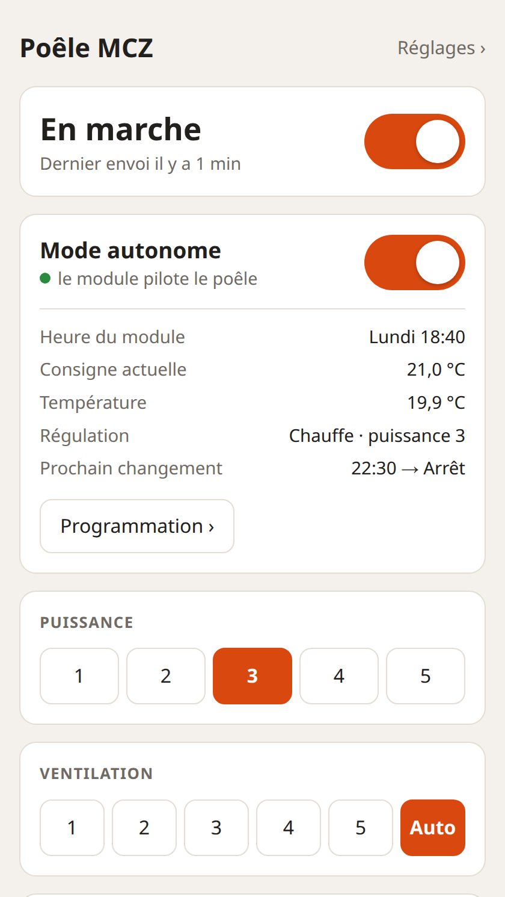
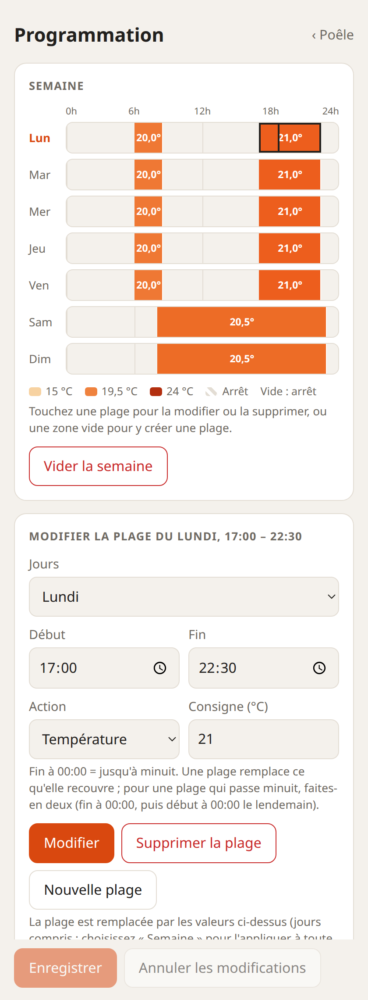
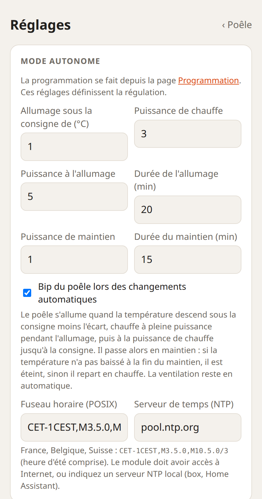

# MCZ WiFi : télécommande WiFi pour poêle à granulés MCZ

Pilotez votre poêle MCZ depuis votre téléphone, votre ordinateur ou **Home Assistant**, sans
toucher au poêle : un petit module WiFi remplace la télécommande radio d'origine.

- Marche / arrêt, puissance de flamme (1 à 5), ventilation (1 à 5 ou auto)
- Mode autonome : programmation hebdomadaire et régulation de température (avec la sonde
  DS18B20 optionnelle)
- Page web intégrée, utilisable depuis n'importe quel navigateur
- Intégration automatique dans Home Assistant (MQTT)
- Portée radio supérieure à celle de la télécommande d'origine
- Mise à jour du module sans câble

> Testé sur un **MCZ Ego Air 2.0** avec télécommande radio **868 MHz**.
>
> **433 ou 868 MHz ?** Les poêles MCZ fonctionnent par défaut dans la bande **433 MHz**
> (434,50 MHz). MCZ propose aussi une version **868 MHz** (868,95 MHz), destinée aux installations
> qui subissent des interférences en 433 MHz. Le protocole est exactement le même dans les deux
> bandes : seule la fréquence change. Le firmware gère les deux (**Réglages › Radio › Bande de
> fréquence**), mais le **module radio RFM69 doit être de la même bande que votre poêle** (voir
> ci-dessous). En cas de doute, regardez la fréquence indiquée sur la télécommande d'origine ou
> dans la notice du poêle.

---

## 1. Matériel nécessaire (environ 15 à 25 €)

| Élément | Remarque |
|---|---|
| **Wemos D1 mini** (ESP8266) | ou un clone compatible |
| **Shield WeMos RFM69** de ch2i | [schémas et infos](https://github.com/hallard/WeMos-RFM69) — voir ci-dessous pour s'en passer |
| **Module radio RFM69HW, version 433 ou 868 MHz** | **la même bande que votre poêle** (voir ci-dessous). Les modèles RFM69W / RFM69CW fonctionnent aussi (moins de portée) |
| **Antenne** | un simple fil rigide soudé sur la sortie antenne suffit : **8,2 cm** en 868 MHz, **17,3 cm** en 433 MHz |
| **Câble micro-USB et chargeur USB 5 V** | pour alimenter le module en permanence |

**Choisir la bonne version du module radio.** Le RFM69 existe en version 433 MHz et en version
868 MHz (la bande est indiquée dans la référence chez le vendeur, par ex. « RFM69HW 433 MHz »).
La puce est la même et le firmware est identique, mais les composants d'adaptation d'antenne
soudés sur le module sont calculés pour une seule bande : un module 868 réglé sur 433 MHz (ou
l'inverse) n'émet presque rien et le poêle ne recevra rien. Il faut donc :

| Poêle / télécommande d'origine | Module RFM69 | Antenne (fil rigide) | Réglage « Bande de fréquence » |
|---|---|---|---|
| 433 MHz (par défaut chez MCZ) | version **433 MHz** | **17,3 cm** | 433 MHz (434,50 MHz) |
| 868 MHz | version **868 MHz** | **8,2 cm** | 868 MHz (868,95 MHz) |

Il faut savoir faire quelques soudures simples (module radio sur le shield, connecteurs).

**Boîtier** : un boîtier à imprimer en 3D (deux pièces, deux vis M3), avec une variante percée
pour la sonde de température, est fourni avec ses instructions de montage dans
[`boitier/`](boitier/README.md).

**Sans le shield**, on peut relier directement un module RFM69 à la Wemos avec des fils :

| RFM69 | Wemos D1 mini |
|---|---|
| 3.3V | 3V3 |
| GND | G |
| NSS | D0 |
| SCK | D5 |
| MISO | D6 |
| MOSI | D7 |

Le module radio est alimenté en **3,3 V uniquement** : ne jamais le relier au 5 V.

### Option : sonde de température DS18B20

Le module peut mesurer la température de la pièce avec une sonde **DS18B20** (version étanche sur
câble, environ 2 €). La mesure s'affiche sur la page du module et dans Home Assistant, où elle
peut servir de sonde à un thermostat. Sans sonde, le module fonctionne normalement.

Matériel en plus :
- une sonde **DS18B20 sur câble** (3 fils) ;
- une **résistance CMS de 4,7 kΩ** (« 472 ») de la taille des pastilles **R1** du shield
  (comparez avec une résistance 0805 ou 0603 avant d'acheter).

La sonde se branche sur le connecteur **I2C** du shield, les 4 trous marqués
**3V3 · GND · SCL · SDA** au dos de la carte, près de la prise d'antenne. Ce connecteur et les
emplacements de résistances voisins (« 4.7K R2 R1 — I2C Pullup ») sont vides d'origine.

1. **Souder la résistance de 4,7 kΩ sur l'emplacement R1.** D'après le schéma du shield, R1 relie
   SDA au 3,3 V : c'est la résistance de tirage dont la sonde a besoin. Vérifiez-le avant de
   souder : à l'ohmmètre (ou au testeur de continuité), une pastille de R1 doit être reliée au
   trou **SDA**, l'autre au trou **3V3**. Laissez **R2** (SCL) vide.
2. **Souder les 3 fils de la sonde** dans le connecteur :

| Fil de la sonde DS18B20 | Trou du connecteur I2C |
|---|---|
| rouge (VDD) | **3V3** |
| noir (GND) | **GND** |
| jaune (DQ, données) | **SDA** (= D2 de la Wemos) |

Les couleurs peuvent varier selon le fabricant : en cas de doute, fiez-vous à la fiche de la sonde.

La sonde est détectée automatiquement au démarrage (puis recherchée toutes les minutes si elle
manque) et lue toutes les 30 secondes. Placez-la **hors du boîtier**, au bout de son câble (le fond `fond-sonde.stl` du
[boîtier](boitier/README.md) est percé pour ce câble) :
dans le boîtier, la chaleur de la Wemos fausserait la mesure. Éloignez-la aussi du poêle et de
son flux d'air chaud. Une correction de quelques dixièmes de degré peut être réglée dans
**Réglages › Sonde de température**.

Pour vérifier le branchement, regardez la ligne **Température** du cadre **Module** sur la page
d'accueil : voyant vert et mesure si la sonde répond, orange « détectée, mesure en cours… » juste
après la détection, gris « non détectée » sinon (elle apparaît dans la minute qui suit le
branchement, sans redémarrer le module).

## 2. Installer le logiciel sur le module

Aucun logiciel à installer sur l'ordinateur : tout se fait depuis le navigateur **Chrome** ou
**Edge** (Firefox et Safari ne savent pas parler au port USB).

1. Téléchargez le fichier **`mcz-wifi-x.y.z-complet.bin`** depuis la
   [dernière version publiée](../../releases/latest).
2. Branchez la Wemos à l'ordinateur avec le câble USB.
   *Sous Windows, si rien n'est détecté, installez le pilote « CH340 » (puce USB de la Wemos).*
3. Ouvrez l'outil officiel d'Espressif : **https://espressif.github.io/esptool-js/**
4. Cliquez sur **Connect** et choisissez le port de la Wemos (souvent « USB Serial » ou « CH340 »).
5. Cliquez sur **Erase Flash** et attendez la fin (efface un éventuel ancien programme).
6. Dans la ligne d'adresse, laissez **`0x0`**, choisissez le fichier `…-complet.bin`, puis
   cliquez sur **Program**. Comptez une minute environ.
7. Débranchez puis rebranchez la Wemos.

## 3. Connecter le module à votre WiFi

1. Avec votre téléphone, connectez-vous au réseau WiFi **`MCZ-xxxxxx`**
   (mot de passe : **`mczconfig`**). La première LED du module clignote en bleu.
2. La page de configuration s'ouvre toute seule. Sinon, ouvrez **http://192.168.4.1**.
3. Cliquez sur **Rechercher les réseaux**, choisissez votre box, saisissez son mot de passe
   (l'icône en forme d'œil permet de vérifier ce que vous tapez), puis **Enregistrer**.
4. Le module rejoint votre réseau. Reconnectez votre téléphone à votre WiFi habituel, puis ouvrez
   **http://poele-mcz.local**. Si cette adresse ne marche pas (fréquent sous Android), utilisez
   l'adresse IP du module, visible dans l'interface de votre box (appareil « poele-mcz »).

Conseil : dans **Réglages › Sécurité**, définissez un mot de passe pour l'interface (utilisateur
`admin`), sinon n'importe qui sur votre réseau peut commander le poêle.

## 4. Appairer le poêle avec le module

Le poêle n'obéit qu'à la télécommande avec laquelle il a été appairé. Chaque module a son propre
identifiant (visible dans **Réglages › Poêle**). Deux possibilités :

**A. Appairer le poêle avec le module** (cas général)

L'appairage se fait depuis le **panneau d'urgence**, à l'arrière du poêle (petit écran, deux LEDs,
sélecteurs et boutons). Procédure de la notice MCZ, chapitre « Synchronisation de la
télécommande » :

1. Ouvrez la page d'accueil du module sur votre téléphone, à portée de main.
2. Vérifiez que le **sélecteur « D »** du panneau d'urgence est sur **REMOTE**.
3. Éteignez le poêle avec l'interrupteur général (à l'arrière), puis rallumez-le.
4. Dès que le premier message s'affiche sur l'écran du panneau d'urgence, appuyez sur le
   **bouton « G »** avec un objet pointu (cure-dent, trombone).
5. Trois tirets clignotants **« --- »** s'affichent : le poêle attend une télécommande.
   Cliquez alors sur **Renvoyer la commande** dans la page du module.
6. Les tirets disparaissent et le poêle émet un signal sonore : l'appairage est fait.

La télécommande d'origine ne sera plus reconnue ensuite : c'est normal, le poêle ne retient
qu'une seule télécommande. Pour la réutiliser, refaites la procédure en appuyant sur son bouton
marche/arrêt à l'étape 5.

*Procédure décrite dans la notice de l'Ego ; la télécommande étant commune à plusieurs modèles
MCZ, elle devrait être la même sur les autres poêles. En cas de doute, voir la notice de votre
poêle (chapitre « Panneau d'urgence »).*

**B. Reprendre l'identifiant de la télécommande d'origine** (si vous le connaissez, par exemple
lu avec un boîtier RFXCOM) : saisissez-le dans **Réglages › Poêle › Identifiant**. Aucun
appairage n'est alors nécessaire.

**Si le poêle ne réagit pas** : dans **Réglages › Radio**, vérifiez que :
- la **bande de fréquence** correspond à celle de votre poêle (433 ou 868 MHz) **et** à la version
  de votre module RFM69 ;
- le **modèle de module** correspond au vôtre (inscription sur le module : « RFM69HW » ou
  « RFM69W »). Avec un mauvais réglage, le module n'émet presque rien.

## 5. Utilisation

La page d'accueil du module permet d'allumer et d'éteindre le poêle, et de régler la puissance
et la ventilation. Chaque commande est envoyée immédiatement ; le poêle bipe à la réception.
Poêle arrêté, un changement de puissance ou de ventilation est seulement mémorisé : il sera
appliqué au prochain allumage (sans bip du poêle).

**À savoir :**
- **Le poêle ne renvoie aucune information** : le module affiche le dernier ordre envoyé, pas
  l'état réel du poêle. Si quelqu'un utilise la télécommande d'origine, l'affichage peut être faux.
- **Retirez les piles de la télécommande d'origine** : elle renvoie régulièrement ses propres
  réglages et écraserait ceux du module.
- Le module renvoie son état toutes les 5 minutes, **sans bip**, comme le fait la télécommande
  d'origine (réglable dans **Réglages › Poêle**).
- Les modes Manuel / Auto / Eco de la télécommande n'existent pas ici : ils sont gérés par la
  télécommande elle-même et ne changent rien au poêle. Pour réguler sur la température, utilisez
  le **mode autonome** du module (ci-dessous) ou un thermostat Home Assistant.
- Si une sonde DS18B20 est branchée, la température s'affiche dans le cadre **Module**.
- Après une coupure de courant, le module **n'envoie rien** au poêle : il ne risque pas de
  l'allumer ou de l'éteindre par surprise (sauf si le mode autonome est actif : il reprend alors
  la régulation).

**Bouton du module** : appui court = marche / arrêt du poêle ; appui long (8 s, LEDs violettes)
= effacement du WiFi et retour au réseau `MCZ-xxxxxx` de configuration.

**LEDs du module**

| LED | Couleur | Signification |
|---|---|---|
| 1 | bleu clignotant | en attente de configuration WiFi (réseau `MCZ-xxxxxx`) |
| 1 | vert | tout fonctionne |
| 1 | orange | WiFi OK, mais Home Assistant (MQTT) injoignable |
| 1 | rouge | WiFi perdu, ou module radio non détecté |
| 2 | orange | poêle en marche |
| 2 | flash blanc | commande envoyée (flash rouge : échec radio) |

### Mode autonome

Le module peut piloter le poêle tout seul, selon une **programmation hebdomadaire** et la
température de la pièce. Il faut la **sonde DS18B20** (voir « Option : sonde de température ») et
l'accès à Internet pour l'heure (ou un serveur de temps local, voir **Réglages › Mode autonome**).

  
  &nbsp;
  

**Programmation** (bouton **Programmation** de la page d'accueil) : chaque jour a ses propres
plages, chacune avec une **température de consigne** ou **Arrêt**. En dehors des plages, le poêle
est arrêté.
- **Créer une plage** : choisissez les jours (**tous les jours**, **semaine** du lundi au vendredi,
  **week-end**, ou un seul jour), le début, la fin et l'action, puis **Appliquer**. Une nouvelle
  plage remplace ce qu'elle recouvre. Fin à 00:00 = jusqu'à minuit.
- **Modifier ou effacer** : touchez une plage dans la vue de la semaine, elle est chargée dans le
  formulaire ; changez-la puis **Appliquer**, ou **Effacer la période**. De 00:00 à 00:00,
  « Effacer la période » vide toute la journée.
- **Copier une journée** vers une autre, vers la semaine, le week-end ou tous les jours.
- **Vider la semaine** efface toutes les plages (second appui pour confirmer).
- Rien n'est envoyé au module avant **Enregistrer**.

**Régulation** (valeurs réglables dans **Réglages › Mode autonome**) :

| Phase | Puissance | Passage à la phase suivante |
|---|---|---|
| Arrêt | poêle éteint | la température descend **1 °C sous la consigne** → Allumage |
| Allumage | **5** pendant **20 min** | consigne atteinte → Maintien, sinon → Chauffe |
| Chauffe | **3** | consigne atteinte → Maintien |
| Maintien | **1** pendant **15 min** | température pas redescendue → **Arrêt** ; elle a baissé → Chauffe |

- La ventilation reste en **automatique**.
- Une plage **Arrêt**, ou l'absence de plage, éteint le poêle immédiatement.
- Sans mesure de température pendant 5 minutes, le poêle est éteint ; sans sonde, il n'est jamais
  allumé.
- **Sans Internet** : une fois l'heure reçue, le module la garde et tout continue normalement. S'il
  **redémarre sans accès au serveur de temps**, il ne connaît plus l'heure : la programmation est
  suspendue et la régulation continue sur la **dernière consigne connue**, sans jamais rallumer le
  poêle. Un poêle allumé est donc régulé puis éteint normalement, au lieu de chauffer sans
  limite ; une fois éteint, il le reste jusqu'au retour de l'heure. Un serveur de temps local
  (box, Home Assistant) dans **Réglages › Mode autonome** évite ce cas.
- **Toute commande manuelle** (page web, Home Assistant, bouton du module) **désactive le mode
  autonome** : réactivez-le avec l'interrupteur de la page d'accueil.
- Pendant le maintien, une baisse de 0,1 °C est tolérée (précision de la sonde).

Une **démo** de l'interface (poêle et pièce simulés, temps accéléré) se construit avec
`python3 tools/make_demo.py`, puis s'ouvre dans un navigateur : `build/demo/index.html`.

## 6. Home Assistant

1. Il faut l'intégration **MQTT** dans Home Assistant (par exemple avec le module complémentaire
   « Mosquitto broker »).
2. Dans **Réglages › MQTT / Home Assistant** du module : cochez **Activer MQTT**, saisissez
   l'adresse du serveur (celle de Home Assistant si vous utilisez Mosquitto) et, si besoin,
   l'utilisateur et le mot de passe MQTT. Enregistrez.
3. Le poêle apparaît automatiquement : **Paramètres › Appareils et services › MQTT › Poêle MCZ**.
   Aucune notification « nouvel appareil » ne s'affiche : allez directement le chercher là.

Entités créées : interrupteur **Poêle**, **Puissance** (1 à 5), **Ventilation** (1 à 5 / auto),
bouton **Renvoyer la commande**, capteur **Signal WiFi** et, si une sonde DS18B20 est branchée,
capteur **Température** (il devient « indisponible » si la sonde ne répond plus ; s'il ne vous
sert plus, supprimez-le dans Home Assistant), interrupteur **Mode autonome**, capteurs
**Consigne** (inconnue pendant un arrêt programmé) et **Régulation** (phase en cours).

## 7. Mettre à jour le module

Téléchargez depuis la [dernière version](../../releases/latest) les fichiers
**`mcz-wifi-x.y.z-firmware.bin`** et **`mcz-wifi-x.y.z-interface.bin`**, puis ouvrez
**Réglages › Maintenance › Mettre à jour** :

1. partie **Firmware** : envoyez `…-firmware.bin`. Le module redémarre ;
2. revenez sur la même page, partie **Interface web** : envoyez `…-interface.bin`. Le module
   redémarre.

Les réglages, l'état du poêle et la programmation sont conservés aux deux étapes. Envoyez
toujours le firmware en premier : c'est lui qui conserve les réglages lors de l'envoi de
l'interface.

**Depuis la version 1.1.0**, faites d'abord l'étape 1 avec la version 1.2.1 ou plus récente.
L'ancien firmware ne conservait pas les réglages lors de l'envoi de l'interface.

N'utilisez pas le fichier `…-complet.bin` pour une mise à jour : il effacerait vos réglages.

## 8. Dépannage

| Problème | Solution |
|---|---|
| Le réseau `MCZ-xxxxxx` n'apparaît pas | Vérifiez l'alimentation USB ; refaites l'étape 2 |
| Mot de passe WiFi erroné | Le module rouvre `MCZ-xxxxxx` au bout de 20 s : recommencez l'étape 3 |
| LED 1 rouge fixe dès le démarrage | Module radio non détecté : vérifiez ses soudures et son orientation |
| Le poêle ne réagit pas | Sélecteur « D » du panneau d'urgence sur **REMOTE** ; modèle de module (Réglages › Radio) ; appairage (étape 4) ; rapprochez le module du poêle |
| Portée faible | Vérifiez que l'antenne du poêle (à l'arrière, près du panneau d'urgence) est vissée jusqu'en butée, partie mobile vers le haut |
| Le poêle change de réglage tout seul | La télécommande d'origine a encore ses piles |
| Température « non détectée » | Sonde DS18B20 : vérifiez la résistance de 4,7 kΩ sur R1 et les fils (jaune sur SDA). Le module la recherche toutes les minutes |
| Mode autonome : « heure inconnue » | Le module n'accède pas au serveur de temps : vérifiez l'accès à Internet ou indiquez un serveur NTP local dans **Réglages › Mode autonome**. En attendant, il régule sur la dernière consigne sans rallumer le poêle |
| Le mode autonome s'est désactivé | Une commande manuelle a été envoyée (page web, Home Assistant, bouton) : réactivez-le |
| `poele-mcz.local` introuvable | Utilisez l'adresse IP du module (voir votre box) |
| Mot de passe de l'interface oublié | Réinstallez le module (étape 2, avec **Erase Flash**) puis refaites la configuration |

## Avertissement

Projet personnel, sans lien avec MCZ. Il n'intervient pas sur les sécurités du poêle, qui restent
assurées par le poêle lui-même, mais vous l'utilisez sous votre seule responsabilité. Ne dépassez
pas la puissance autorisée dans **Réglages › Radio** : 14 dBm (25 mW) en 868 MHz, 10 dBm (10 mW)
en 433 MHz.

## Pour les développeurs

Compilation, architecture du code, protocole radio, API REST et topics MQTT :
voir la [documentation technique](docs/TECHNIQUE.md).

## Licence

[GPL-3.0](LICENSE). Le shield WeMos RFM69 est une création de Charles-Henri Hallard (ch2i),
sous sa propre licence.
