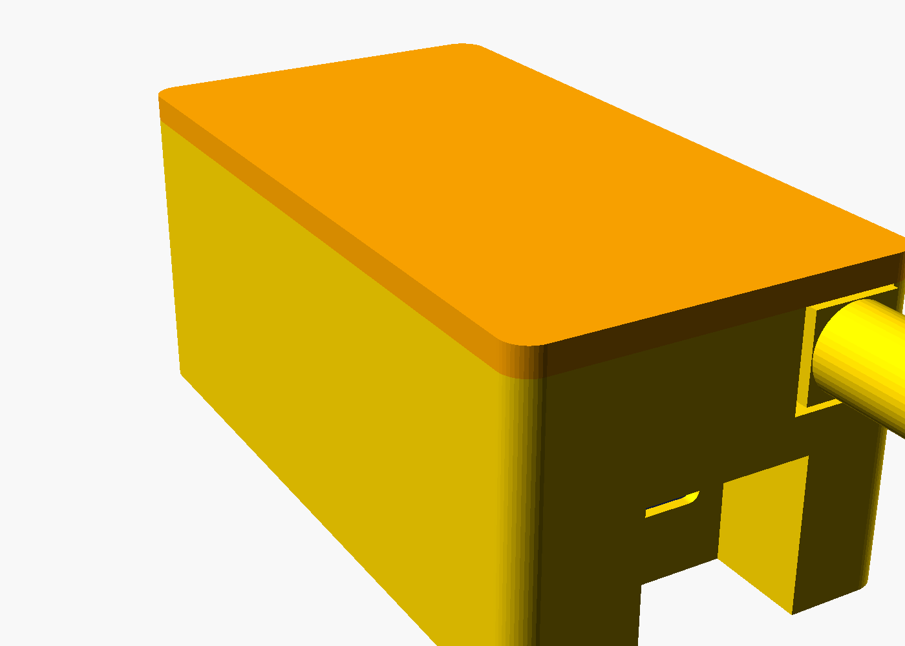
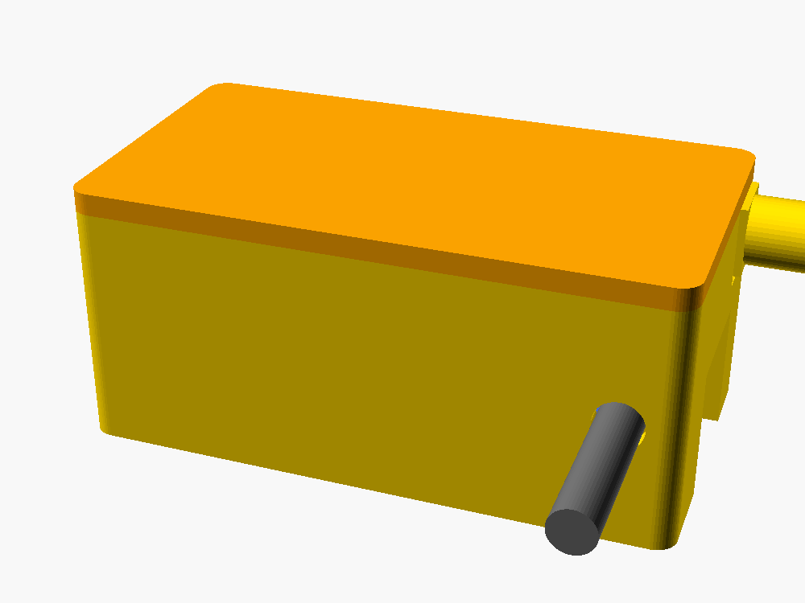

# Boîtier imprimé

Boîtier en deux pièces pour Wemos D1 mini + shield WeMos RFM69 Gateway (ch2i), assemblé par
deux vis M3 cachées sous le boîtier. Dimensions extérieures : 54,7 × 29,5 × 24,5 mm (hors
antenne).

| Fichier | Rôle |
|---|---|
| `fond.stl` | fond, version standard |
| `fond-sonde.stl` | fond percé pour le câble de la sonde de température DS18B20 optionnelle |
| `couvercle.stl` | couvercle (le même pour les deux fonds) |
| `boitier.scad` | modèle OpenSCAD paramétrique (source des STL) |



## Impression

- PLA ou PETG, buse 0,4 mm, couches 0,2 mm, **sans support**.
- Les STL sont déjà orientés : le fond posé sur sa face inférieure, le couvercle retourné, face
  lisse sur le plateau.

## Matériel

- 2 vis **M3 × 10 DIN 912** (tête cylindrique à six pans creux, clé de 2,5 mm). Elles se vissent
  directement dans le plastique : pas d'écrou ni d'insert.
- Pour la version sonde : une sonde **DS18B20 étanche sur câble** (gaine Ø 4 mm), la carte étant
  préparée comme indiqué dans le [README](../README.md#option--sonde-de-température-ds18b20)
  (résistance CMS de 4,7 kΩ sur R1).

## Montage

Repères : la paroi **côté antenne** est celle qui a l'encoche en U pour la prise SMA ; contre la
paroi opposée se trouve le **bloc de butée**, traversé par les deux trous de vis.

### 1. (Version sonde uniquement) Câbler la sonde

À faire **avant** de mettre la carte dans le fond, car le câble doit passer par le trou.



1. Passez l'extrémité libre du câble de la sonde dans le trou du fond, **de l'extérieur vers
   l'intérieur** (le trou est dans la grande paroi opposée à la prise SMA, près de la paroi côté
   antenne).
2. Dénudez la gaine sur environ 4 cm : les 3 fils doivent rejoindre le connecteur I2C du shield
   en passant au-dessus du tunnel USB.
3. Les cartes étant assemblées (shield sur la Wemos), enfilez les 3 fils dans le connecteur I2C
   **par le dessous du shield** (côté Wemos), puis soudez-les sur le dessus : rouge → **3V3**,
   noir → **GND**, jaune → **SDA**. Coupez ce qui dépasse au ras des soudures : le couvercle
   arrive juste au-dessus.

   Les fils doivent entrer par le dessous : au-dessus du shield, il n'y a pas de place pour un
   câble sous le couvercle.
4. Tirez doucement le câble vers l'extérieur pour qu'il ne reste pas de boucle dans le boîtier,
   en laissant juste assez de mou aux fils pour poser la carte à l'étape suivante.

### 2. Poser la carte dans le fond

1. Présentez la pile Wemos + shield, **Wemos en bas**, prise micro-USB et SMA du côté de la paroi
   côté antenne.
2. Engagez l'embase carrée de la SMA dans l'encoche en U, puis descendez la carte à plat : la
   prise micro-USB vient en face du petit trou au fond du tunnel USB.
3. Poussez la carte vers la paroi côté antenne : le bord du shield vient contre cette paroi et
   le bout de la Wemos s'arrête contre le bloc de butée. La carte est alors tenue en longueur.

La Wemos repose sur deux bossages placés sous ses trous de fixation. Il n'est pas nécessaire de
la visser.

### 3. Fermer le couvercle

Le couvercle se verrouille en coulissant : rien ne s'incline ni ne force.

1. Posez le couvercle à plat sur le fond, **décalé d'environ 1,5 mm vers le côté opposé à
   l'antenne**, et laissez-le descendre jusqu'en bas.
2. **Poussez-le vers l'antenne** : la lèvre du couvercle entre dans la rainure de la paroi côté
   antenne, et le couvercle arrive au ras de toutes les parois et du dessus de l'embase SMA.
3. Retournez le boîtier en tenant le couvercle et vissez les **2 vis M3 × 10** par-dessous, à
   travers le bloc de butée, dans la cloison du couvercle. Les têtes se logent dans leurs
   lamages. Serrez sans forcer : la vis taraude le plastique, un serrage excessif l'arracherait.

### 4. Raccordement

Vissez l'antenne sur la prise SMA, puis branchez le câble micro-USB dans le tunnel, sans forcer.
Placez la sonde éventuelle loin du poêle et de son flux d'air chaud.

### Démontage

Dévissez les 2 vis, tirez le couvercle d'environ 1,5 mm vers le côté opposé à l'antenne pour
dégager la lèvre, puis soulevez-le.

## Modifier le modèle

Toutes les cotes sont des paramètres en tête de `boitier.scad`. Pour régénérer les STL :

```sh
openscad -D 'part="base"' -o fond.stl boitier.scad
openscad -D 'part="base"' -D 'probe=true' -o fond-sonde.stl boitier.scad
openscad -D 'part="lid"' -o couvercle.stl boitier.scad
```

`part` permet aussi d'afficher `assembly` (assemblé), `exploded` (éclaté), `section` (coupe) ou
`print` (les deux pièces côte à côte). Avec `probe=true`, le câble de la sonde apparaît dans les
aperçus. Le diamètre du trou se règle avec `probe_cable_d` (diamètre de la gaine, jeu de
0,5 mm ajouté).
